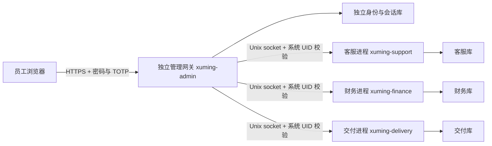

# 独立网页管理后台

本后台是独立的 Django 5.2 LTS 服务与 React 页面，和客户起名网站使用不同端口、域名、身份数据库及会话。没有默认账号。功能已接通内部登记；真实支付、客户报告存储、自动生成与交付、集中审计尚未接入。

| 岗位 | 网页能力 | 服务端边界 |
| --- | --- | --- |
| 经营者 | 各岗位汇总、创建和停用员工、账号授权记录 | 无权读取岗位明细或操作岗位任务 |
| 客服 | 工单分类、关联服务 UUID、状态流转、查询关联服务的状态摘要、本岗位审计 | 不得读取财务、报告、授权和尝试令牌，不能操作交付任务 |
| 财务 | 收入/支出手工登记、一次冲销、本岗位汇总及审计 | 不执行收付款，不开放新增退款，不得读取客服资料 |
| 交付 | 授权和需求摘要登记、开始/重试、失败/完成、本岗位审计 | 不验证支付、不保存或生成客户报告，不得读取财务或客服库 |

账号创建时确定岗位；调整职责时停用原账号并重新开通对应岗位账号，保留原操作记录。经营者能授予其他人员岗位，因此经营者和系统管理员均属于可信管理角色。后台网关自身也属于受信任的授权边界，若网关被攻破，单靠分库不能防止越权指令；需配合主机与网络防护。

## 身份与会话

- 使用 Django 密码哈希、会话和 CSRF 校验；密码至少 12 位并检查常见密码与账号相似度。密码和动态码不能通过 URL 提交。
- 每位员工必须配置 TOTP 验证器，不提供仅密码登录。动态码不可重复使用；首次登录必须修改初始密码。
- 会话绝对有效期 30 分钟，不因轮询延长；退出、停用账号或恢复凭据后，原会话失效。使用 HttpOnly、Secure、SameSite=Strict Cookie；不将凭据或业务数据写进 localStorage，也不注册后台离线缓存。
- 账号连续失败 5 次后锁定 15 分钟；锁定持久保存在独立身份库。按账号锁定覆盖不同来源地址；反向代理另做 IP 限速，避免把代理回环地址当成所有员工的来源地址。
- 新账号的验证器密钥只在创建响应中显示一次，不能从员工列表再次读取。通过可信渠道交付，不保存到共享截图或聊天记录中。身份库中含验证器密钥，必须保护文件、备份及主机；当前未提供数据库字段加密。
- 账号审计记录员工编号、动作、时间与关联 UUID；岗位 worker 记录由可信网关传入的员工编号。日志属于本机记录，管理员可修改本机存储，不等于独立防篡改审计。

## 分进程部署



网关不直接打开岗位数据库。各 worker 只绑定 Unix socket，校验调用方真实系统 UID，只支持本岗位固定指令与字段，不接受任意 SQL、文件路径或角色切换。原 CLI 继续可用；原表新增审计操作人、客服关联服务编号及财务请求键，保留旧记录。财务网页为每次提交生成 UUID，网络重试复用同一请求键；相同键不能对应不同金额或收支类型。旧 CLI 如需同样去重，可使用 `--request-key`。

客服通过独立只读投影查询服务状态，仅返回服务 UUID、状态、尝试次数和更新时间；不返回付款授权、需求摘要、报告摘要或执行令牌。岗位数据库之间不直接连接。

需要 Python 3.10+（本地验证版本为 3.12）及前端构建环境。以下是待管理员审核的部署准备，尚未在目标服务器执行：

1. 在只读代码目录安装 `pip install -r requirements-backoffice.txt`；执行 `npm ci --prefix frontend`、`npm run build --prefix frontend`，生成独立 `admin.html` 与客户首页。
2. 创建不同的低权限账户 `xuming-admin`、`xuming-support`、`xuming-finance`、`xuming-delivery`，公网应用继续使用 `xuming`。准备管理员独占的 `/var/lib/xuming-admin` 和各岗位独占的 `/var/lib/xuming-ops/{support,finance,delivery}`，目录权限 `0700`，数据库权限 `0600`，父目录由管理员控制且不可被业务账号改写。不要共用公网服务可写目录。
3. 创建管理员控制的 `/etc/xuming/admin.env`（root 拥有、`0600`，由 systemd 读取），包含 `XUMING_ADMIN_SECRET`（至少 50 位随机字符）、`XUMING_ADMIN_HOME=/var/lib/xuming-admin`、`XUMING_ADMIN_HOSTS=ops.实际域名`、`XUMING_ADMIN_TRUST_PROXY=1`。不得设置 `XUMING_ADMIN_DEV=1`。密钥通过密码管理器生成并注入，不提交 Git，不在命令参数或日志中暴露。
4. `/etc/xuming/worker.env` 由管理员控制，填写 `ADMIN_UID=管理网关账号的实际数字UID`。安装并审核 [网关服务示例](../deploy/xuming-admin.service.example) 和 [worker 模板](../deploy/xuming-worker@.service.example)。worker 的 socket 目录由各自账户拥有、组为 `xuming-admin`，模式 `0750`，socket 模式 `0660`；即使其他进程能连接，UID 校验仍只允许网关账户。业务数据库仍保持角色独占 `0700`。
5. 在管理账户、相同受保护环境下运行 `python manage_backoffice.py migrate` 和 `python manage_backoffice.py create_operator 经营者账号 --role owner`。创建命令在可信终端交互读取密码并展示验证器设置地址，不需要也不应通过命令行传入密码。可以通过 root 管理员的临时 systemd 服务使用上述 EnvironmentFile 执行管理命令，交互开通时使用 `systemd-run --pty`。
6. 启动三个 worker 实例和网关；仅绑定 `127.0.0.1:4180`。参考 [管理域名代理示例](../deploy/nginx-admin.conf.example) 配置独立 HTTPS 域名，限制 VPN/办公网访问并设置登录限速。代理必须覆盖转发头且应用端口不可直接从公网访问；仅在这种条件下启用 `XUMING_ADMIN_TRUST_PROXY`。后台域名不要交给客户网站的 service worker 控制，不要跨域共享 Cookie。
7. 以 `xuming-admin` 的受保护运行环境执行 `python manage_backoffice.py check --deploy`；验证角色之间及公网账户不能直接读取数据库、错误 UID 无法调用 socket、每个岗位的真实账号无法调用其他岗位接口，确认 TLS、备份、恢复和集中审计策略后再开放。

验证器丢失或需要重置时，管理员在可信终端用同一受保护运行环境执行 `python manage_backoffice.py reset_operator 员工账号`，重新交付验证器并强制修改密码；默认不恢复已停用账号，需显式加 `--reactivate`。重置操作会留存记录并使旧凭据和会话失效。不能通过网页找回或查询已有验证器密钥。

## 开发与验证

只有明确本地调试时设置 `XUMING_ADMIN_DEV=1` 关闭 HTTPS 重定向和 Secure Cookie，并仅监听回环地址；同样需要随机密钥、私有身份目录及真实开通的账号。生产模式始终默认启用 HTTPS、严格 Cookie、CSP、点击劫持防护和禁止缓存。

```sh
python3 -m unittest discover -s tests
python3 manage_backoffice.py test backoffice --settings=backoffice.test_settings
node --test tests/test_*.js
CHROMIUM_PATH=/usr/bin/chromium npm --prefix frontend run test:e2e
CHROMIUM_PATH=/usr/bin/chromium npm --prefix frontend run test:e2e:admin
```

`backoffice.test_settings` 和 `scripts/backoffice_e2e.py` 仅供测试。浏览器夹具使用临时目录、固定测试凭据和模拟岗位身份，并仅监听 `127.0.0.1:4192`，不能作为部署入口，不能用来宣称完成了目标主机的操作系统隔离验收。生产 worker 的岗位检查不会被关闭。
