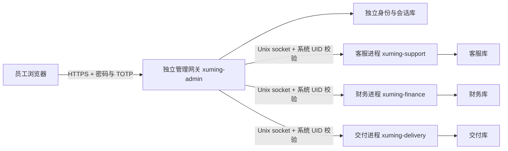

# 独立网页管理后台

本后台是独立的 Django 5.2 LTS 服务与 React 页面，和客户起名网站使用不同端口、域名、身份数据库及会话。没有固定默认账号；首次部署通过管理命令生成唯一的随机超级管理员。功能已接通内部登记与经营者完整报告工作台；公开内测报告由独立加密服务保存，用户主动开启后可直接查看；经营者可管理免费总额、暂停开放、查看/导出报告与处理反馈。历史人工交付报告仍保留。页面采用 Radix Themes 3.3.0、Lucide 与星际东方风格，操作区保持清晰的表格、岗位导航与报告预览。真实支付、自动发送与集中审计尚未接入。报告服务部署及完整边界见 [报告交付说明](../reports/OPERATOR_REPORTS.md)，账号变更见 [超级管理员说明](../reports/SUPERADMIN_AND_UI.md)，当前页面与操作见[公开内测工作台](../reports/PUBLIC_BETA_QUOTA.md)。

| 岗位 | 网页能力 | 服务端边界 |
| --- | --- | --- |
| 超级管理员 | 唯一的初始化管理身份，具备经营者工作台、员工授权及报告能力 | 不绕过客服、财务、交付岗位边界；不能从网页新增第二个或停用该账号 |
| 经营者 | 各岗位汇总、员工管理、授权审计，以及客户主动提交的报告查看、导出、删除和人工交付 | 无权读取客服/财务/原交付岗位明细或操作其任务 |
| 客服 | 工单分类、关联服务 UUID、状态流转、查询关联服务的状态摘要、本岗位审计 | 不得读取财务、报告、授权和尝试令牌，不能操作交付任务 |
| 财务 | 收入/支出手工登记、一次冲销、本岗位汇总及审计 | 不执行收付款，不开放新增退款，不得读取客服资料 |
| 交付 | 授权和需求摘要登记、开始/重试、失败/完成、本岗位审计 | 不验证支付、不保存或生成客户报告，不得读取财务或客服库 |

账号创建时确定岗位；调整职责时停用原账号并重新开通对应岗位账号，保留原操作记录。经营者能授予其他人员岗位，因此经营者和系统管理员均属于可信管理角色。后台网关自身也属于受信任的授权边界，若网关被攻破，单靠分库不能防止越权指令；需配合主机与网络防护。

## 身份与会话

- 使用 Django 的 Argon2id 单向密码哈希、会话和 CSRF 校验；旧 PBKDF2 哈希在成功验证后升级。密码至少 12 位并检查常见密码与账号相似度。数据库不保存可还原的登录密码，密码和动态码不能通过 URL 提交。
- 超级管理员用户名和初始密码使用系统安全随机源生成，数据库唯一约束禁止第二个超级管理员标记。初始凭据只写入管理账户独占目录的 `initial-superadmin.json`（0600），不输出到服务日志；首次成功改密或可信终端恢复凭据后删除。重复启动不会重置密码、验证器或重新生成该文件。
- 每位员工必须配置 TOTP 验证器，不提供仅密码登录。动态码不可重复使用；首次登录必须修改初始密码。
- 会话绝对有效期 30 分钟，不因轮询延长；退出、停用账号或恢复凭据后，原会话失效。使用 HttpOnly、Secure、SameSite=Strict Cookie；不将凭据或业务数据写进 localStorage，也不注册后台离线缓存。
- 账号连续失败 5 次后锁定 15 分钟；锁定持久保存在独立身份库。按账号锁定覆盖不同来源地址；反向代理另做 IP 限速，避免把代理回环地址当成所有员工的来源地址。
- 新账号的验证器密钥只在创建响应中显示一次，不能从员工列表再次读取。通过可信渠道交付，不保存到共享截图或聊天记录中。身份库中含验证器密钥，必须保护文件、备份及主机；当前未提供数据库字段加密。
- 账号审计记录员工编号、动作、时间与关联 UUID；岗位 worker 记录由可信网关传入的员工编号。日志属于本机记录，管理员可修改本机存储，不等于独立防篡改审计。

## 分进程部署



网关不直接打开岗位数据库。各 worker 只绑定 Unix socket，校验调用方真实系统 UID，只支持本岗位固定指令与字段，不接受任意 SQL、文件路径或角色切换。原 CLI 继续可用；原表新增审计操作人、客服关联服务编号及财务请求键，保留旧记录。财务网页为每次提交生成 UUID，网络重试复用同一请求键；相同键不能对应不同金额或收支类型。旧 CLI 如需同样去重，可使用 `--request-key`。

客服通过独立只读投影查询服务状态，仅返回服务 UUID、状态、尝试次数和更新时间；不返回付款授权、需求摘要、报告摘要或执行令牌。岗位数据库之间不直接连接。

需要 Python 3.10+（本地验证版本为 3.12）及前端构建环境。以下是部署准备，尚未在目标服务器执行：

1. 在只读代码目录安装 `pip install -r requirements-backoffice.txt`；执行 `npm ci --prefix frontend`、`npm run build --prefix frontend`，生成独立 `admin.html` 与客户首页。
2. 创建不同的低权限账户 `xuming-admin`、`xuming-support`、`xuming-finance`、`xuming-delivery`，公网应用继续使用 `xuming`。准备管理员独占的 `/var/lib/xuming-admin` 和各岗位独占的 `/var/lib/xuming-ops/{support,finance,delivery}`，目录权限 `0700`，数据库权限 `0600`，父目录由管理员控制且不可被业务账号改写。不要共用公网服务可写目录。
3. 创建管理员控制的 `/etc/xuming/admin.env`（root 拥有、`0600`，由 systemd 读取），包含 `XUMING_ADMIN_SECRET`（至少 50 位随机字符）、`XUMING_ADMIN_HOME=/var/lib/xuming-admin`、`XUMING_ADMIN_HOSTS=ops.实际域名`、`XUMING_ADMIN_TRUST_PROXY=1`。不得设置 `XUMING_ADMIN_DEV=1`。密钥通过密码管理器生成并注入，不提交 Git，不在命令参数或日志中暴露。
4. `/etc/xuming/worker.env` 由管理员控制，填写 `ADMIN_UID=管理网关账号的实际数字UID`。安装并审核 [网关服务示例](../deploy/xuming-admin.service.example) 和 [worker 模板](../deploy/xuming-worker@.service.example)。worker 的 socket 目录由各自账户拥有、组为 `xuming-admin`，模式 `0750`，socket 模式 `0660`；即使其他进程能连接，UID 校验仍只允许网关账户。业务数据库仍保持角色独占 `0700`。
5. 新版网关 service 的 `ExecStartPre` 先运行 `migrate --noinput`，再运行 `bootstrap_superadmin --write-credentials`。手动部署时也必须在管理账户、相同受保护环境下执行这两条命令；先安装新版 `requirements-backoffice.txt` 中的 Argon2 依赖。普通员工可在超级管理员登录后从“员工与权限”开通，也可用 `create_operator 员工账号 --role 岗位` 在可信终端交互开通。不会覆盖原有普通经营者；若已存在其他 Django 超级用户，初始化会停止，要求核对原身份。
6. 启动三个 worker 实例和网关；仅绑定 `127.0.0.1:4180`。参考 [管理域名代理示例](../deploy/nginx-admin.conf.example) 配置独立 HTTPS 域名，限制 VPN/办公网访问并设置登录限速。代理必须覆盖转发头且应用端口不可直接从公网访问；仅在这种条件下启用 `XUMING_ADMIN_TRUST_PROXY`。后台域名不要交给客户网站的 service worker 控制，不要跨域共享 Cookie。
7. 以 `xuming-admin` 的受保护运行环境执行 `python manage_backoffice.py check --deploy`；验证角色之间及公网账户不能直接读取数据库、错误 UID 无法调用 socket、每个岗位的真实账号无法调用其他岗位接口，确认 TLS、备份、恢复和集中审计策略后再开放。

验证器丢失或需要重置时，管理员在可信终端用同一受保护运行环境执行 `python manage_backoffice.py reset_operator 员工账号`，重新交付验证器并强制修改密码；默认不恢复已停用账号，需显式加 `--reactivate`。重置操作会留存记录并使旧凭据和会话失效。不能通过网页找回或查询已有验证器密钥。

## 首次登录

登录后，经营者可进入“体验反馈与内测”创建一次性内测邀请、查看匿名生成记录、处理用户主动提交的体验意见，并按编号查找内测完整报告。提案反馈与报告反馈分开统计，其他岗位不能访问。操作与服务部署见[体验反馈与内测说明](../reports/EXPERIENCE_FEEDBACK.md)。

1. 完成上述独立后台部署后，访问你实际配置的管理 HTTPS 域名。客户网站不是管理入口；仓库不包含预设的线上管理员密码。
2. 服务器管理员在可信终端读取初始文件：`sudo -u xuming-admin cat /var/lib/xuming-admin/initial-superadmin.json`。若修改了 `XUMING_ADMIN_HOME`，使用实际路径。这个文件只由服务器管理账户读取，不能从网站下载；不要将输出上传 Git、共享终端记录或发到聊天中。
3. 将 `authenticator_key` 导入验证器，选择基于时间、6位、30秒，或使用支持 `otpauth` 的密码管理器导入 `totp_uri`。校准手机与服务器时间。用文件里的随机账号、初始密码和当前动态码登录。
4. 页面强制设置并确认新密码；成功后初始凭据文件自动删除，再进入“完整报告”或“员工与权限”。验证器仍用于后续登录，账号不会因重启而改变。

如果初始文件已经清除，使用你保存的账号、新密码与验证器；不要重新执行初始化来试图找回密码。遗失凭据按上方 `reset_operator` 恢复流程处理。初始化文件保留明文仅为首次交付，登录密码在数据库中始终以 Argon2id 哈希保存。

## 开发与验证

只有明确本地调试时设置 `XUMING_ADMIN_DEV=1` 关闭 HTTPS 重定向和 Secure Cookie，并仅监听回环地址；同样需要随机密钥、私有身份目录及真实开通的账号。生产模式始终默认启用 HTTPS、严格 Cookie、CSP、点击劫持防护和禁止缓存。

```sh
python3 -m unittest discover -s tests
python3 manage_backoffice.py test backoffice --settings=backoffice.test_settings
node --test tests/test_*.js
CHROMIUM_PATH=/usr/bin/chromium npm --prefix frontend run test:e2e
CHROMIUM_PATH=/usr/bin/chromium npm --prefix frontend run test:e2e:admin
```

`backoffice.test_settings` 和 `scripts/backoffice_e2e.py` 仅供测试。浏览器夹具使用临时目录、固定员工测试凭据、临时随机超级管理员和模拟岗位身份，并仅监听 `127.0.0.1:4192`。随机凭据通过0600临时文件传给测试进程，夹具退出时清除，不增加任何HTTP获取凭据接口；不能作为部署入口，不能用来宣称完成了目标主机的操作系统隔离验收。生产 worker 的岗位检查不会被关闭。

当前公开内测：登录后进入“体验反馈与内测”→“免费体验名额设置”。初始100份，总额不能低于累计已用；可暂停新报告，已有报告不受影响。名额管理只向经营者/超级管理员开放，不向客服、财务或交付开放。
