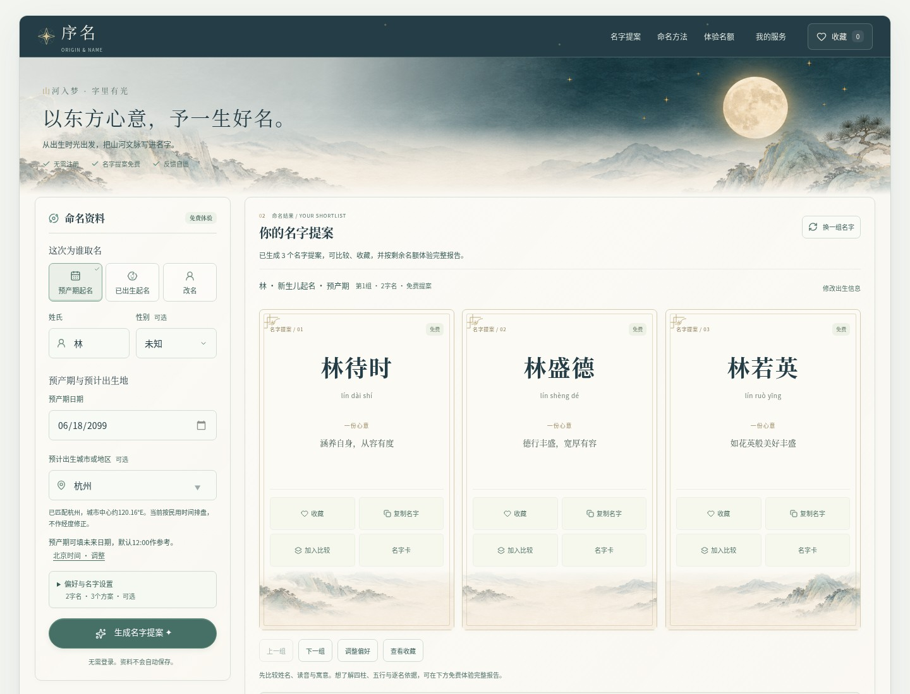
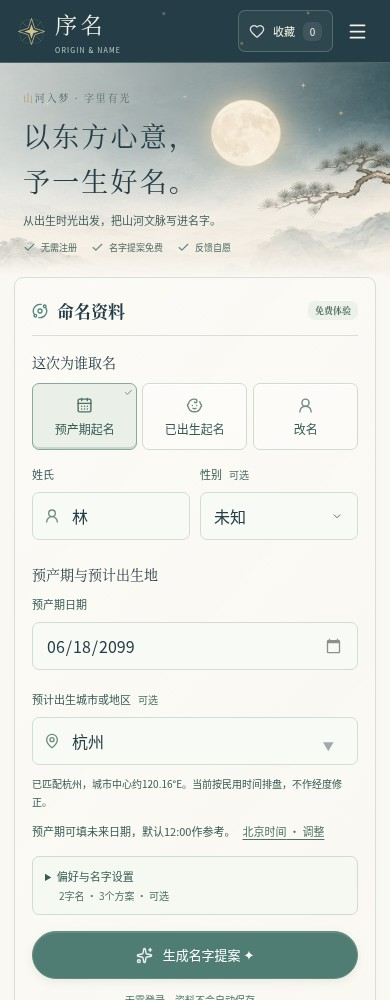

# 月白青黛参考图落地

本轮以用户提供的选定示意图为视觉依据，调整页面构图与装饰素材：青黛窄导航、带月亮和松枝的水墨横幅、暖白纸面，以及带山水底饰与细金边的名字卡。以下为实际 React 页面运行截图，使用合成资料和隔离的临时测试数据库。

## 实际页面

桌面端：



手机端：



更多实页：

- [整页提案与真实测试名额](images/reference-client-proposals.jpg)
- [手机名字卡](images/reference-name-card-mobile.jpg)
- [完整报告](images/reference-client-report.jpg) / [手机报告](images/reference-client-report-mobile.jpg)
- [自愿反馈表](images/reference-client-feedback-mobile.jpg)
- [后台登录](images/reference-admin-login.jpg) / [手机登录](images/reference-admin-login-mobile.jpg)
- [经营总览](images/reference-admin-overview.jpg) / [名额设置](images/reference-admin-quota.jpg)
- [员工权限](images/reference-admin-staff.jpg) / [历史报告](images/reference-admin-reports.jpg) / [修改密码](images/reference-admin-password.jpg)
- [客服](images/reference-admin-support.jpg) / [财务](images/reference-admin-finance.jpg) / [交付](images/reference-admin-delivery.jpg)
- [本机生成的心愿卡](images/reference-keepsake.png) / [心愿卡编辑](images/reference-client-keepsake-mobile.jpg)

截图中的名额、工单、收支和报告编号来自临时测试实例；浏览器宽度、实际场景和展开区域有所不同。整页截图将粘性导航放回文档顶部，并隐藏短暂 Toast。

## 设计与实现

| 部位 | 实现 |
| --- | --- |
| 页面框架 | 月白外底、居中纸面应用框，青黛导航与古金品牌细节 |
| 山水横幅 | 本地水墨插画，保留完整圆月；远山分层衔接纸面，文字使用真实 DOM |
| 表单 | 桌面左栏、手机通栏；统一48px输入和玉青焦点，三个业务场景各自保留输入 |
| 名字提案 | 桌面三列，较窄双列、手机单列；宋体姓名、读音和寓意居中，金边与角饰、山水底图 |
| 名额 | 真实名额横条放在提案之后，保留刷新、过时响应保护与错误状态 |
| 报告与反馈 | 暖白阅读纸面、古金侧线、青黛标题、玉青操作，保留焦点与关闭行为 |
| 后台 | 青黛岗位导航、纸面表格、山水欢迎区；登录页共享同一套插画 |
| 下载卡片 | Canvas 使用同源山水素材绘制，可离线制作和下载，姓名与祝愿由用户填写 |

共享视觉样式集中在 `frontend/src/ui/landscape-theme.css`。Vite 会把两端共享 CSS 提取到入口样式之前，样式中的重复主题类有意提高优先级，防止旧入口样式覆盖。嵌套表单和结果区单独设为满宽，避免手机端重复缩进。

装饰插画为本轮生成并随仓库发布的 `frontend/src/assets/moon-mountains.png`，约2.38MB，由同源构建资源提供，服务工作线程缓存后可离线使用。它用于界面装饰；姓名、寓意、报告与名额继续由业务数据渲染。青黛为 `#243D46`，外底为 `#F3F5F1`，纸面为 `#FAF8F2`，玉青为 `#56877E`，古金为 `#B59C68`；主按钮采用较深的 `#507D73` 承载白字。

## 验证与更新

- 生产构建通过，27项 Node 检查、52项客户浏览器流程、5项客户账号流程和10项后台/报告浏览器流程通过。
- 手动核对320、390、768、850、1024、1280、1440px页面，无横向溢出；截图过程未出现页面脚本异常。
- 使用临时数据库实际生成预产期提案、领取报告、打开反馈、制作名字卡，并检查经营者、客服、财务与交付页面。
- `scripts/check_site.py` 核对 React 入口、构建资源、预产期、已出生与改名现名分析通过。

复现检查：

```sh
npm --prefix frontend run build
node --test tests/test_*.js
CHROMIUM_PATH=/usr/bin/chromium npm --prefix frontend run test:e2e -- --workers=2
CHROMIUM_PATH=/usr/bin/chromium npm --prefix frontend run test:e2e:customer
CHROMIUM_PATH=/usr/bin/chromium npm --prefix frontend run test:e2e:admin
```

本轮在代码工作区完成并核对，目标服务器尚未更新。服务器需拉取代码、重新构建 `frontend/dist` 并重启已有服务；只拉代码后重启可能继续提供旧构建。更新步骤见[部署说明](../deploy/README.md)。
