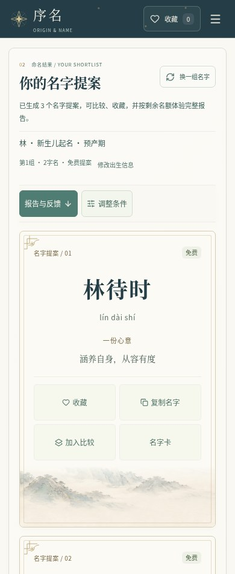
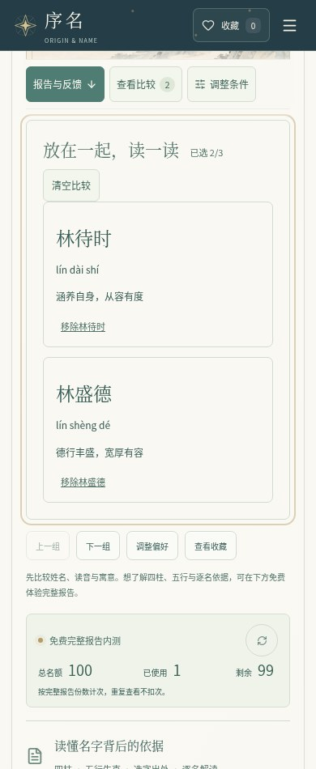

# 月白青黛：手机操作与加载优化

在用户已确认的青黛导航、月色山水和纸面名字卡基础上，继续改善实际操作：生成后直接进入结果，可快速前往报告区和已选名字比较，手机工具栏保持一行，比较标题完整显示。

## 实页截图





[桌面实页](images/refine-desktop.jpg) · [报告领取区域](images/refine-mobile-report-entry.jpg)

截图来自临时测试服务及合成资料，名额计数属于测试实例；图中文字、姓名与按钮均为运行中的 React 元素。

## 操作改进

- 生成成功后聚焦结果区，键盘用户可以继续操作；校验失败仍定位表单问题，重新生成失败保留旧结果。
- 报告快捷入口定位至含保存说明的报告区，随后由用户主动点击领取；跳转本身不请求报告、不使用名额。
- 选择名字后出现“查看比较”及真实已选数，可跨组保留选择。320px手机工具栏保持一行，跳转后比较标题避开导航和工具栏。
- 可从快捷栏回到调整条件；修改资料后报告入口随原有过期状态收起，避免误读上一份报告。
- 名字卡的拼音、寓意提示、操作文字和免费标识提高可读性，统一选择框下拉提示。
- 心愿卡下载等待同源山水素材和字体就绪，制作期间防止重复下载；素材失败会提示重试，网络恢复后可再次制作。

## 资源与服务

同一幅2172×724山水插画由2,380,593字节PNG转为116,434字节WebP，传输体积减少95.11%，页面构图和配色保持一致。PNG原稿保留在仓库，当前构建只发布被引用的WebP。已有服务工作线程缓存覆盖该资源，离线制作心愿卡流程已验证。

转换命令：

```sh
magick frontend/src/assets/moon-mountains.png -define webp:method=6 -quality 84 frontend/src/assets/moon-mountains.webp
```

上述转换只用于重制素材；日常安装和构建使用仓库内现成WebP，无需安装ImageMagick。后台静态资源仅增加WebP格式支持，并保留文件名限制和构建资源目录检查。

## 验证

生产构建及128项相关检查通过：56项客户浏览器流程、5项客户账号流程、10项后台/报告浏览器流程、30项后台Python检查、27项Node检查。

新增检查覆盖生成后的键盘焦点、320/390/1280px比较跳转不被遮挡、素材失败重试与成功下载、报告定位不触发领取、后台WebP类型及目录访问限制。素材故障测试单独关闭服务工作线程，保证故障请求实际经过测试拦截；离线用例继续验证真实缓存。

手动浏览器检查320、390、620、768、850、1024、1280、1440px页面，无横向溢出；客户与后台的实际WebP请求返回200和正确的`image/webp`。预产期、已出生、改名的站点自检通过。

本轮已在代码工作区验证，目标服务器尚未更新。更新时拉取代码、重新构建前端，再重启客户与后台服务，以加载新的静态资源格式支持；步骤见[部署说明](../deploy/README.md)。
